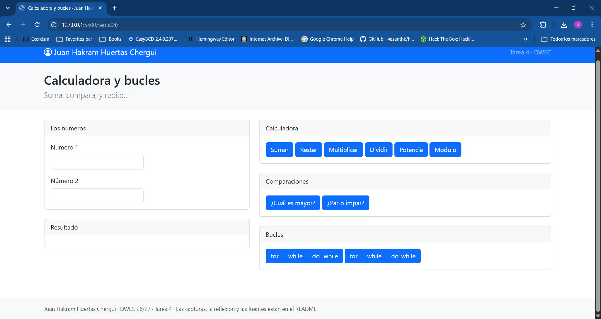
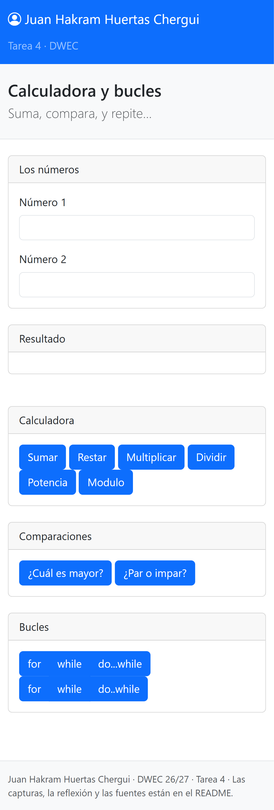
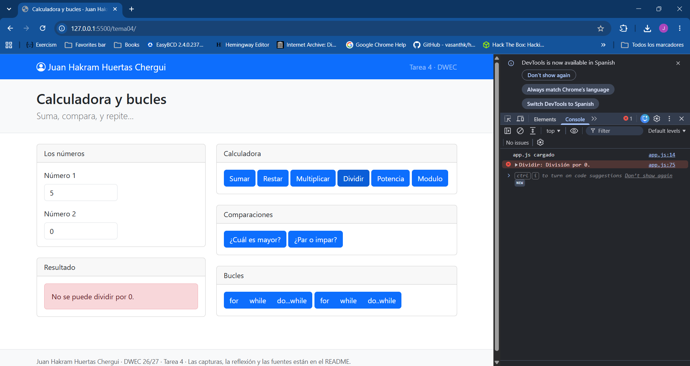
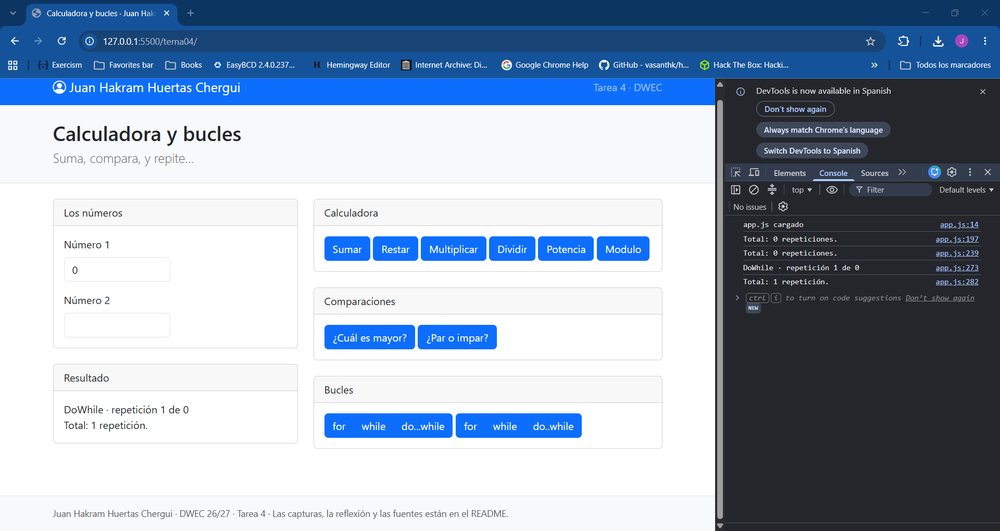
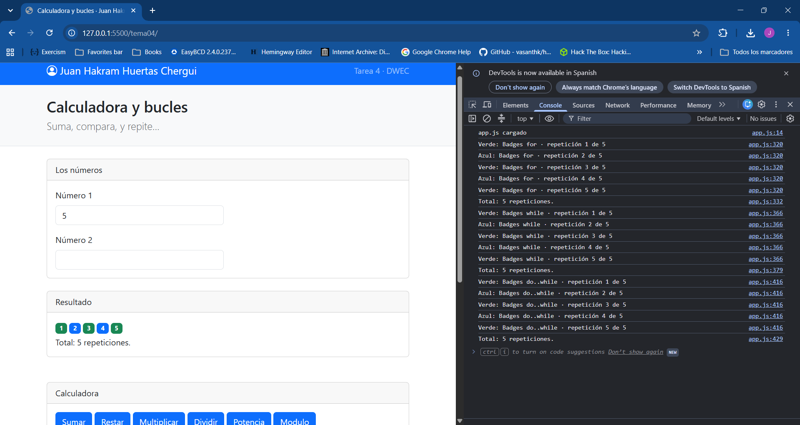

# Tarea 4 · Calculadora y bucles

**Autor:** Juan Hakrma Huertas Chergui · Desarrollo Web en Entorno Cliente (DWEC) · 2.º DAW · Curso 2026-27

> **Plantilla de la tarea 4.** Cómo usarla:
>
> 1. Copia esta carpeta en tu repositorio de DWEC y cámbiale el nombre a `tema04`.
> 2. `index.html` trae lo imprescindible para empezar: las dos casillas, la zona de resultado y el botón «Sumar». El resto de la página y su maquetación con Bootstrap los haces tú.
> 3. `js/app.js` trae `sumar()` hecha como modelo y las demás funciones con `TODO`.
> 4. `js/ayudas.js` no se toca: son las funciones que leen las casillas y escriben el resultado.
> 5. Sustituye las imágenes de `capturas/` por las tuyas, **con el mismo nombre**.
> 6. Todo lo que va entre [corchetes] es un hueco: cámbialo por lo tuyo. Al terminar, borra este aviso.

[Una o dos abrir la carpeta en VS Code, pulsar **Go Live**, escribir dos números y pulsar los botones con la consola abierta (F12).]
Página con una calculadora simple, comparaciones y diferentes tipos de bucles. Los bucles escriben el texto como texto o badges.

## Capturas

### a) La página entera

Se ve la navbar con mi nombre y debajo la cabecera con el título. En modo escritorio, la rejilla reparte las cards en dos columas, izquierda para números y resultados y derecha para la calculadora, comparaciones y los bucles.

### b) La página en el móvil

En el móvil las dos columnas pasan a ocupar todo el ancho de la pantalla y las cards se apilan una encima de la otra.

### c) El error de dividir entre 0

En la página sale en rojo el mensaje: 'No se puede dividir por 0.' y en la consola aparece en rojo, con console.error().

### d) Los tres bucles con el número 0

El y while no se repiten y muestran 0 repeticiones porque se comprueba la condición antes de entrar. El do..while se ejecuta una vez porque primero ejecuta y despues revisa la condición.

### e) Un bucle con badges

Puse el número ´5´ y salen los badges de uno a cinco con color azul y verde intercalado. El color se elige con un operador ternario que comprueba si el numero es par, verde impar y azul par

## Reflexión

[De 5 a 8 líneas: ¿en qué se diferencian for, while y do…while y cuándo usarías cada uno? Pon como ejemplo lo que pasó con el 0.]

Los tres bucles sirven para repetir bloques de codigo, pero cada uno tiene un uso diferente.

El `for` se usa cuando ya se sabe el número de iteraciones de antemano. Es espacialmente util para leer arrays. 

El `while` combrueba la condición antes de cada iteración, y lo usaría cuando no se cuantas veces se va a repetir el bucle. Es utíl para busquedas o para confirmar que un usuario escriba un dato válido.

El `do..while` hace lo mismo que el `while`, solo que ejecuta una vez antes de revisar la condición. Al poner ´0´, se ejecuto una vez aunque no cumplia con los requisitos,. También aprendi a tener cuidado con los bucles infitos por no incluir el contador en algunos bucle y do no copiar y pegar ciegamente.

## Fuentes

- [MDN · Operador condicional (ternario)](https://developer.mozilla.org/es/docs/Web/JavaScript/Reference/Operators/Conditional_operator)
- [Aprende JavaScript · Number](https://www.aprendejavascript.dev/clase/tipos-de-datos-primitivos/number)
- [Bootstrap · Rejilla](https://getbootstrap.com/docs/5.3/layout/grid/)
- [Bootstrap · Grupos de botones](https://getbootstrap.com/docs/5.3/components/button-group/)

## Uso de IA

[Si has usado IA: qué herramienta, para qué y qué hiciste después con su respuesta. Si no la has
- Claude.ai (Anthropic)
Uso: 
 - arreglo de variables no existentes `n1`y `veces`
 - bucles que daban un vuelta de mas. (Empezaba de 0 y en la condición tenia `contador <=veces`).
 - se me olvido `contador++`
 - uso de variable `total`
- Tambien corregir faltas 
Que hice:
- Ir corregiendo los errores, y cuando Claude me recomendaba otro codigo, intentaba arreglar el mi primero.
