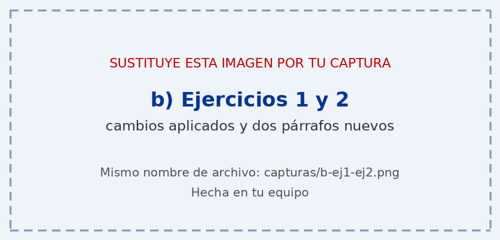
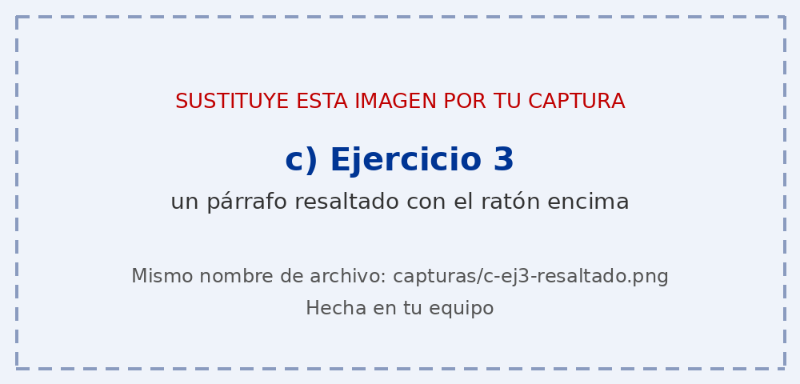
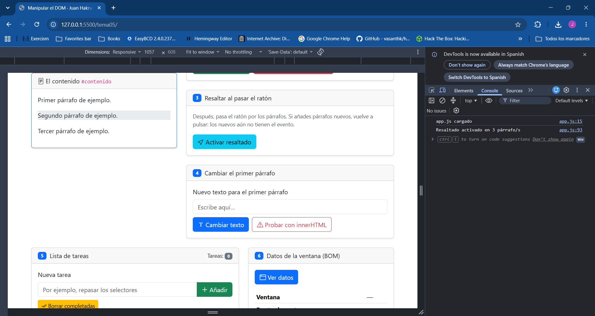
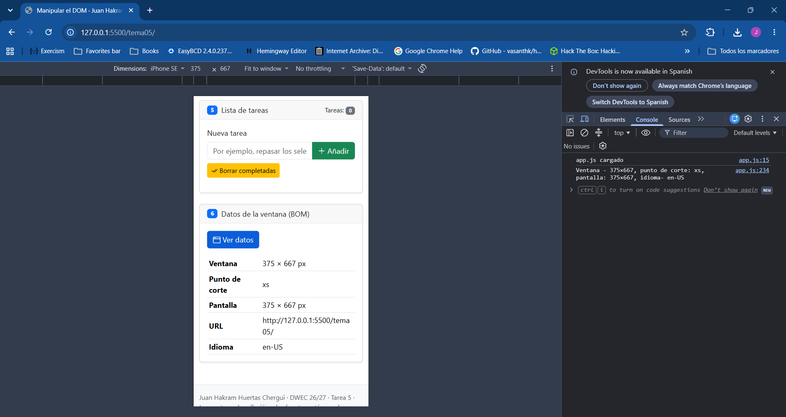

# Tarea 5 · Manipular el DOM

**Autor:** Juan Hakram Huertas Chergui · Desarrollo Web en Entorno Cliente (DWEC) · 2.º DAW · Curso 2026-27

 Abre la carpeta en VS Code, pulsa Go Live y prueba los botones con la consola abierta (F12): cada función deja un mensaje en ella.

## Capturas

### a) La página recién cargada

Se ve mi nombre en la barra de navegación y los tres párrafos de partida. 

### b) Ejercicios 1 y 2

Tras pulsar el boton:
    - Primero: con getElementById, el texto del primer párrafo cambia a "Texto modificado por JavaScript".
    - Segundo: con querySelector, se selecciona la clase y se resalta con color `bg-warning-subtle`.
    -Tercero: con querySelectorAll("#contenido p") y su posicion en lista, se cambia el color rojo.
Después he pulsado Párrafo Nuevo dos veces.

### c) Ejercicio 3: resaltado al pasar el ratón

El párrafo resaltado es el que tiene el ratón dentro del contenedor. Se resalta cuando entra el raton dentro del contenedor y lo pierde cuando sale. Los párrofos añadidos no se resaltan al no tener el evento añadido.

### d) Ejercicio 4: `<b>hola</b>` con innerHTML

Cambiar texto:<b>hola</b> 
innerHTML: **hola**

Con innerHTML, el navegador interpreta las etiqueta y muestra hola en negrita.

### e) Ejercicio 5: la lista de tareas

Se muestra tres tareas con casillas y una marcada, antes de pulsar borrar completadas. 

### f) Ejercicio 6: los datos de la ventana en el móvil

####  Punto de corte:
- móvil: `xs`
- mi pantalla: `xl`

## Reflexión

### ¿Qué diferencia hay entre textContent e innerHTML y por qué no se debe meter en innerHTML lo que escribe el usuario? 

`textContent` trata todo lo que recibo como texto plano. Como el ejemplo de <b>hola</b> donde se mostraban las etiquetas al no ser processadas.

`innerHTML` si lo interpreta como código HTML, por eso el resultado se ve en negrita.

Eso parece inofensivo, pero si lo que se mete en innerHTML lo escribe el usuario, puede colar cualquier etiqueta y hacer un ataque XSS(Cross-Site Scripting). Eso permitiría a un usuaria malicioso robar cookies o sessiones. 

Siempre hay que usar `textContent` para inputs de usuario y innerHTML solo para el propia programador.

## Fuentes

- [HTML DOM Elements](https://www.w3schools.com/jsref/dom_obj_all.asp)

## Uso de IA

He usado Claude (Anthropic) para revisar mi app.js. Le pedí que me dijera qué errores tenía, y me señaló, entre otros, que en anadirTarea() faltaba const, que la clase list-group-item estaba mal escrita y que #error5 se mostraba vacío. También le pedí que me explicara la diferencia entre getElementById y querySelector, y la de textContent frente a innerHTML. Con sus respuestas corregí el código yo mismo, probé cada botón en el navegador con la consola abierta y comprobé que todo funcionaba antes de entregarlo.
