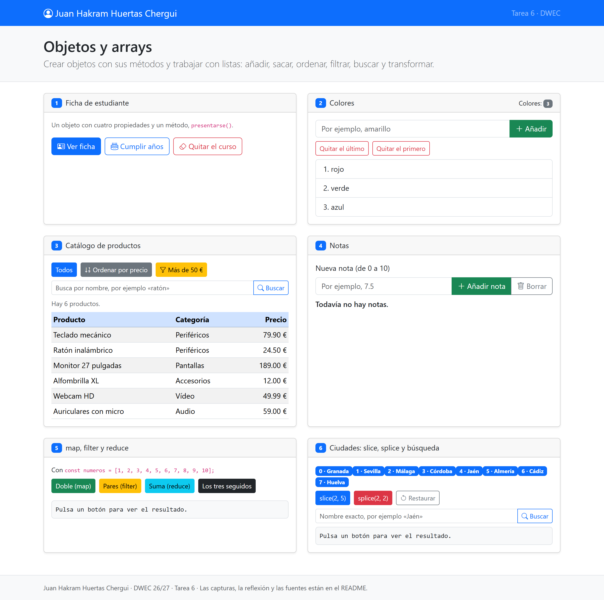
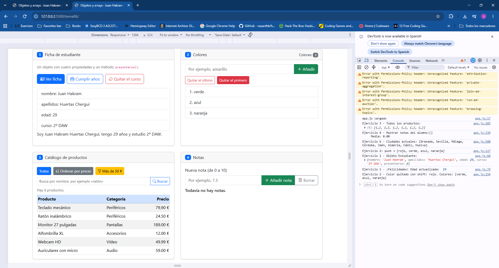
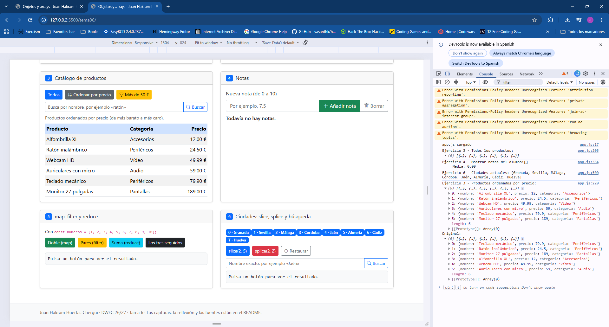
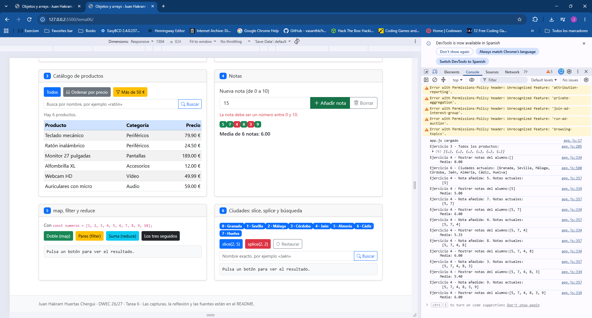
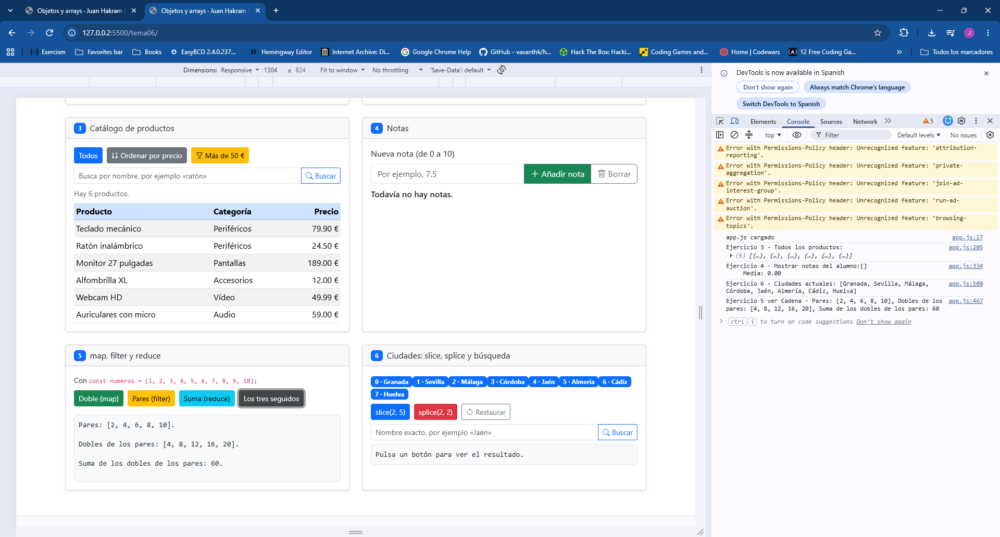
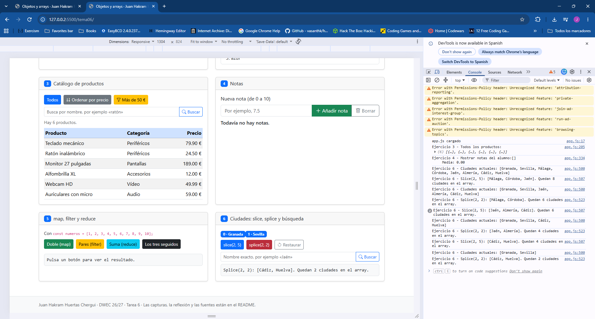

# Tarea 6 · Objetos y arrays

**Autor:** Juan Hakram Huertas Chergui · Desarrollo Web en Entorno Cliente (DWEC) · 2.º DAW · Curso 2026-27

Esta carpeta contiene una página con ejercicios de `arrays` y `objects`.
Para accederla:

1. Abre la carpeta en VS Code.
2. Pulsa Go Live.
3. Abre la consola (F12).
4. Prueba los botones y fijate en el rastro de consola.

## Capturas

### a) La página recién cargada



Al cargar la página sale mi nombre arriba y ya aparecen la lista de colores, la tabla con los seis productos, las ocho ciudades con su número y la tabla de notas.

### b) Ejercicios 1 y 2: la ficha y los colores



En la ficha de estudiante se ha trabajado con un objeto `estudiante` que tiene un método `presentarse()` que devuelve la frase. Dentro del método se usa `this` para utilizar los datos del propio objeto. Con `forEach` se recorren las claves y se saca cada valor con `estudiante[clave]`.

El botón `Cumplir años` suma 1 a la propiedad `edad` con el operador de incremento (`++`).

Cuando se pulsa `Quitar curso`, `delete` borra la propiedad del objeto. Como ya no existe, sale «curso: undefined», porque se intenta leer una propiedad que ya no existe. JavaScript no da error, sino que devuelve `undefined`.

En la lista de colores se ha usado `push()` para añadir un color al final, `pop()` para quitar el último y `shift()` para quitar el primero.

### c) Ejercicio 3: el catálogo ordenado por precio



Para ordenar por precio uso `sort()` con esta función: 

```function (a, b) { return a.precio - b.precio; }```

 Si sale negativo, `a` va antes, así que quedan del más barato al más caro. Hay que ponerle la función porque si no, `sort()` ordena los números como si fueran texto.

Ordeno una copia `([...productos])` y no el array original porque `sort()` cambia el array que ordena.
Si ordenara productos, al darle a `Mostrar todos` ya no saldrían en el orden del principio.

### d) Ejercicio 4: las notas y la media



He añadido seis notas: 5, 7, 4, 8, 3 y 9. Las aprobadas (5 o más) salen en verde y las suspensas en rojo. La media es 6.00, que sale de sumar todas las notas con `reduce()` (36) y dividir entre el número de notas (6).

En la captura también se ve qué pasa con una nota que no vale: he escrito 15 y sale el error `La nota debe ser un número entre 0 y 10`, y no se añade. Antes de guardar una nota, el método `anadirNota()` comprueba que sea un número y que esté entre 0 y 10. Si no lo está, devuelve `false` y se muestra el error. La casilla vacía se comprueba antes de pasar el texto a número, porque `Number("")` da 0 y se guardaría un cero.

### e) Ejercicio 5: los tres métodos seguidos



#### El resultado de filter, map y reduce encadenados

Primero `filter()` se queda con los pares: [2, 4, 6, 8, 10].
Luego `map()` los multiplica por 2: [4, 8, 12, 16, 20].
Y al final `reduce()` los suma y da 60.
El array numeros no cambia en ningún momento.

### f) Ejercicio 6: después de splice y de buscar una ciudad



Con `splice(2, 2)` se han quitado Málaga y Córdoba, que estaban en las posiciones 2 y 3, y quedan 6 ciudades. Luego he buscado Jaén: `includes()` da `true` e `indexOf()` da 2. Antes Jaén estaba en la posición 4, pero como se han quitado dos ciudades que iban delante, las demás se han movido dos sitios.

## Reflexión

Hay métodos que cambian el array original y otros que no. `push`, `pop`, `shift`, `splice` y `sort` lo cambian. `slice`, `map`, `filter` y `reduce` no, devuelven uno nuevo (o un valor, en el caso de reduce). En el ejercicio 6 se ve muy claro: después de slice sigue habiendo 8 ciudades, pero después de splice quedan 6. Por eso en el ejercicio 3 ordeno una copia, porque sort cambiaría el array de productos.

## Fuentes

- [Colecciones indexadas · MDN](https://developer.mozilla.org/es/docs/Web/JavaScript/Guide/Indexed_collections)
- [Método reduce en JavaScript · 4Geeks](https://4geeks.com/es/how-to/metodo-reduce-javascript)
- Diapositivas del tema 6, «Estructura de datos. El array».

## Uso de IA

He usado Claude para revisar mi código. Me encontró algunos fallos que luego arreglé yo: en el ejercicio 5 había puesto a las variables el mismo nombre que a las funciones y usaba `this` donde no tocaba, en el ejercicio 6 contaba mal las ciudades que quedaban, y tenía una letra suelta que daba error al cargar la página. También me dijo qué `console.log` me faltaban y me ayudó a corregir este README, que luego he revisado.
