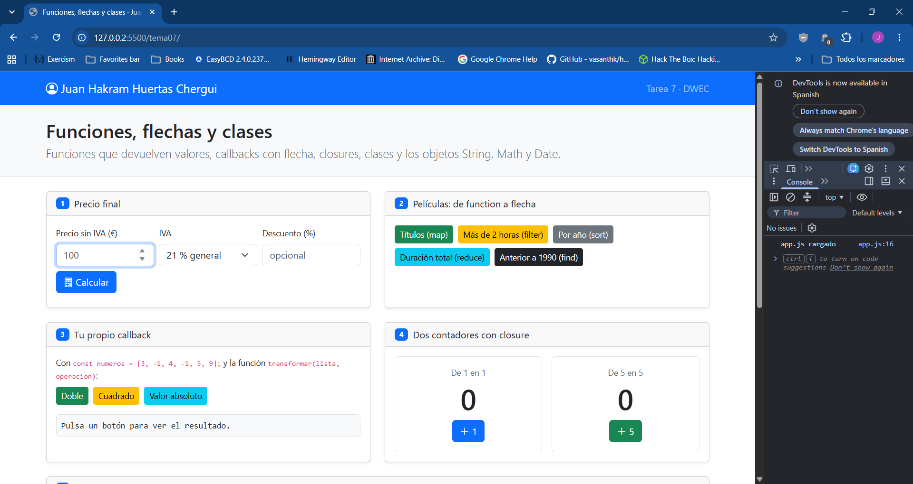
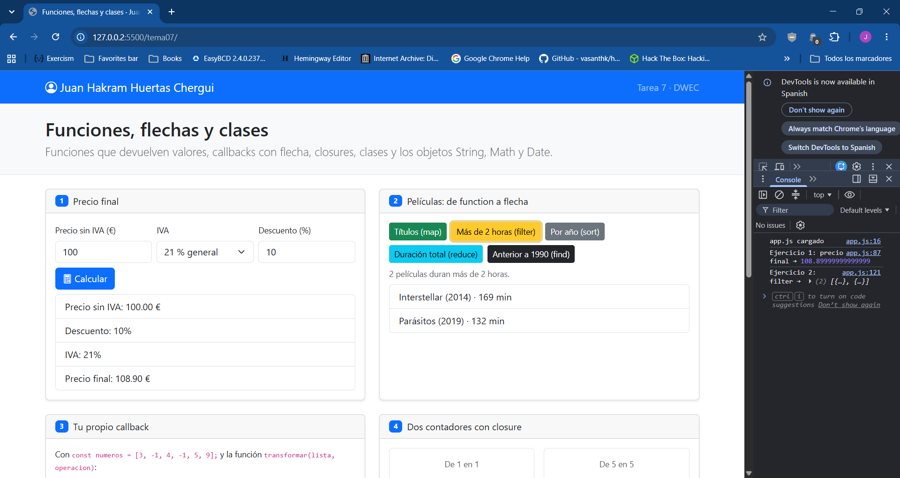
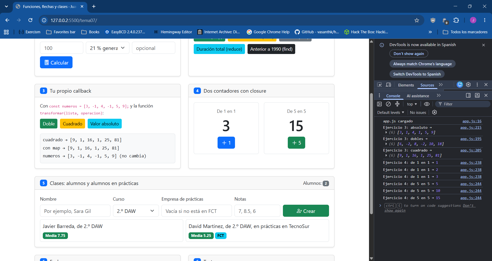
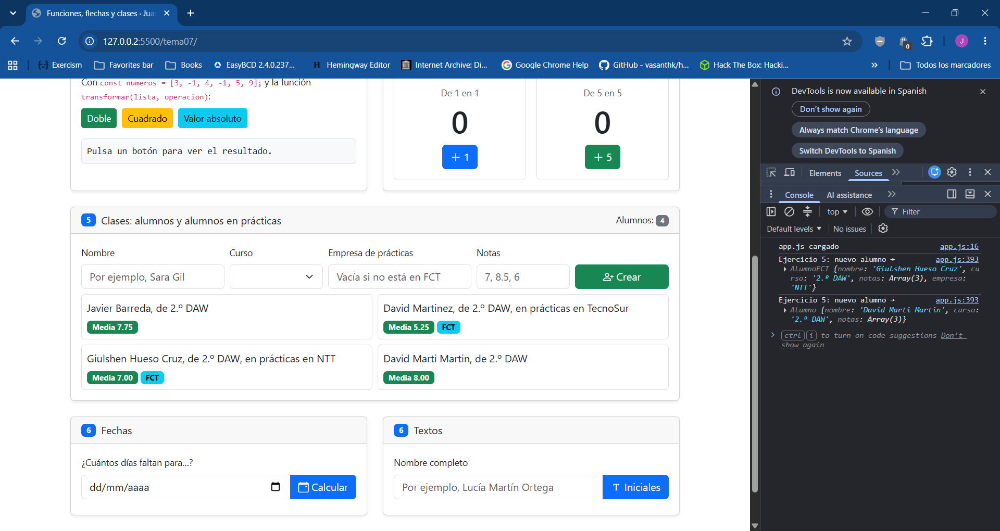
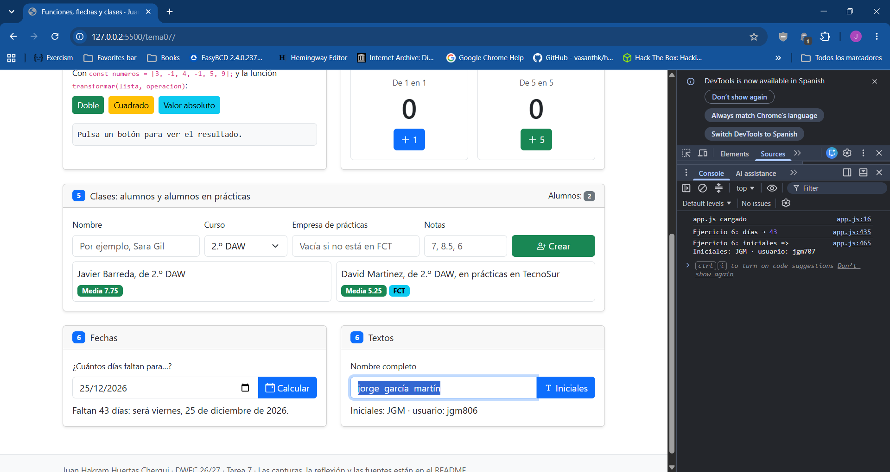

# Tarea 7 · Funciones, flechas y clases

**Autor:** Juan Hakram Huertas Chergui · Desarrollo Web en Entorno Cliente (DWEC) · 2.º DAW · Curso 2026-27

---

Esta carpeta contiene una página con ejercicios de funciones, funciones flecha, closures y clases. Para probarla:

1. Abre la carpeta en VS Code.
2. Pulsa Go Live.
3. Abre la consola (F12).
4. Prueba los botones y fíjate en el rastro de consola.

---

## Capturas

### a) La página recién cargada

Al cargar la página sale mi nombre arriba y en el ejercicio 5 ya aparecen los dos alumnos de partida: Javier Barreda, que es un Alumno, y David Martinez, que es un AlumnoFCT y está en prácticas en TecnoSur.

### b) Ejercicios 1 y 2: el precio y las películas

He puesto una base de 100 €, IVA del 21 % y un descuento del 10 %, y el precio final sale 108.90 €. calcularPrecio() solo hace la cuenta y la devuelve con return. mostrarPrecio() es la que lee las casillas, comprueba los errores y pinta el desglose. Si dejo el descuento vacío, llamo a calcularPrecio(base, iva) sin el tercer argumento y se usa el 0 por defecto.

En las películas he pulsado «Más de 2 horas» y salen Interstellar y Parásitos, con filter().

### c) Ejercicios 3 y 4: tu callback y los contadores

transformar() hace lo mismo que map() pero a mano: recorre la lista con for…of, llama a operacion con cada número y lo guarda en un array nuevo. Con «Cuadrado» sale [9, 1, 16, 1, 25, 81], igual que con map(), y numeros no cambia.

He pulsado tres veces «+1» y tres veces «+5», y los contadores van por 3 y 15. No se mezclan porque cada vez que llamo a crearContador() se crea una variable cuenta nueva, y la función que devuelve se acuerda de la suya. Eso es un closure. Si escribo cuenta en la consola sale ReferenceError, porque cuenta solo existe dentro de crearContador().

### d) Ejercicio 5: los alumnos

He creado dos alumnos más y ya hay cuatro, dos de ellos en prácticas (salen con la etiqueta FCT). En crearAlumno(), si la casilla de empresa está vacía se crea un new Alumno(), y si tiene algo se crea un new AlumnoFCT(). AlumnoFCT hereda de Alumno con extends, y en su presentarse() uso super.presentarse() y le añado lo de las prácticas.

### e) Ejercicio 6: fechas y textos

He probado con el 25 de diciembre de 2026 y sale «Faltan 43 días: será viernes, 25 de diciembre de 2026». Redondeo con Math.round porque con el cambio de hora un día puede tener 23 o 25 horas, y la división no da un número entero.

Abajo he escrito «jorge  garcía  martín» con espacios dobles y salen las iniciales JGM. Los espacios de más se quitan con filter(), y el usuario sale con tres cifras al azar.

## Reflexión

Al pasar un callback de function a flecha se quita la palabra function y se pone =>. Si lo de dentro es solo una expresión, también se quitan las llaves y el return, porque la flecha devuelve el valor sola. Por ejemplo, en verLargas() tenía function (pelicula) { return pelicula.duracion > 120; } y ahora es (pelicula) => pelicula.duracion > 120. El return hace falta cuando pongo llaves, porque si no la función devuelve undefined. Los métodos de las clases no se escriben con flecha porque la flecha no tiene su propio this, y en media() el this.notas no sería el del alumno. Por eso uso la forma corta media() { … }.

## Fuentes

(https://developer.mozilla.org/es/docs/Web/JavaScript/Reference/Classes)

- [Date.prototype.toLocaleDateString() · MDN](https://developer.mozilla.org/es/docs/Web/JavaScript/Reference/Global_Objects/Date/toLocaleDateString)
- [Functions · Eloquent JavaScript](https://eloquentjavascript.net/03_functions.html)
- [JavaScript Nested function · Stack Overflow](https://stackoverflow.com/questions/7295634/javascript-nested-function)

- Diapositivas del tema 7, «Funciones y objetos».

## Uso de IA

He usado Claude para revisar mi código con el enunciado. Me encontró algunos fallos que luego arreglé yo: en crearAlumno() me faltaba el new al crear un Alumno, el error del ejercicio 5 no se ocultaba cuando todo iba bien, y en buscarAntigua() no tenía en cuenta que find() puede devolver undefined. También he solicitado una revisíon del Readme.md.
